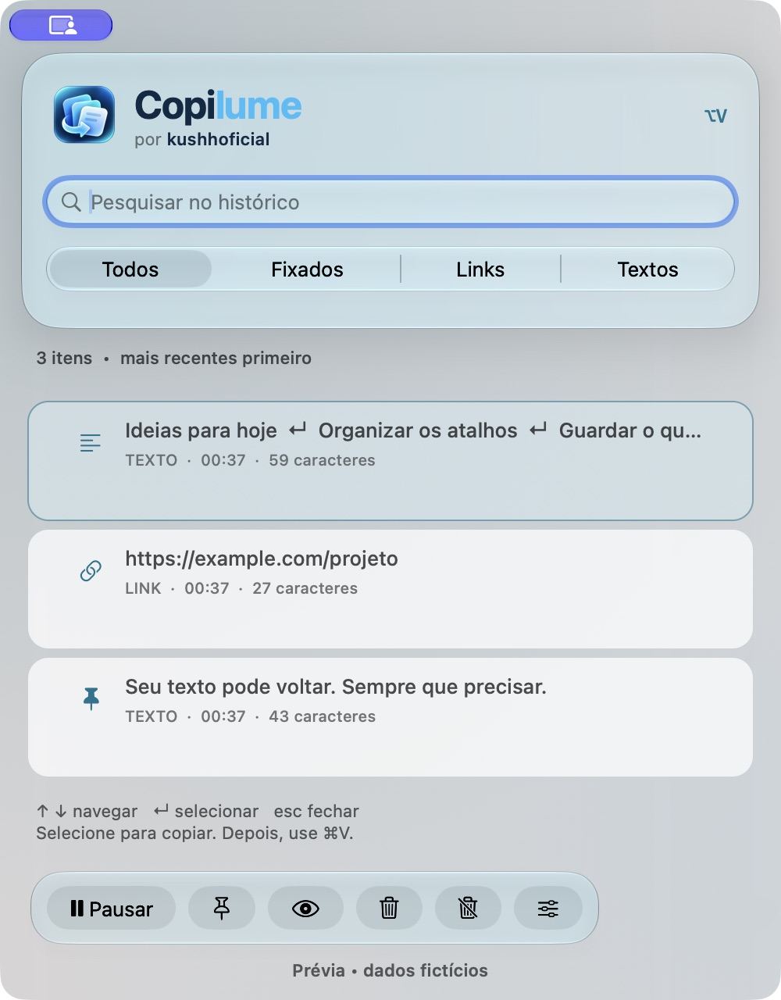
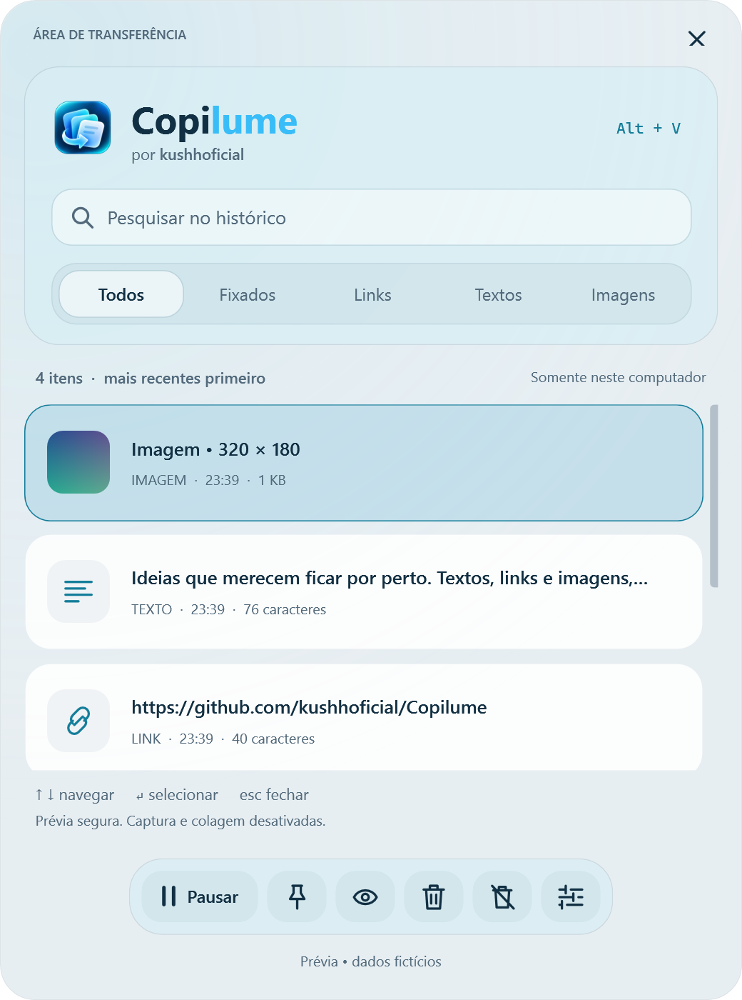

# Copilume

<picture>
  <source media="(prefers-color-scheme: dark)" srcset="Assets/LockupDark.svg">
  
</picture>

**Copie agora. Reencontre depois.** Histórico de textos, links e imagens para **macOS e Windows**, gratuito e open source sob licença [MIT](LICENSE). Por **kushhoficial**.

## Baixar e instalar

Escolha o seu sistema. Cada plataforma tem seu próprio aplicativo, pacote e guia de instalação.

### macOS

[**Baixar para macOS — versão 1.4.2 (.dmg)**](https://github.com/kushhoficial/Copilume/releases/download/v1.4.2/Copilume-1.4.2-universal.dmg)

- **macOS 13+**, em Macs Apple Silicon e Intel; um único DMG universal.
- Abra o DMG, arraste **Copilume.app** para **Applications** e abra pela pasta Aplicativos.
- Atalho padrão: **Option + V**.
- [Instalação, permissões, privacidade e compilação no macOS](docs/MACOS.md).

### Windows

[**Baixar para Windows x64 — versão 1.4.2 (.zip)**](https://github.com/kushhoficial/Copilume/releases/download/v1.4.2/Copilume-1.4.2-windows-x64.zip) · [**Baixar para Windows ARM64 — versão 1.4.2 (.zip)**](https://github.com/kushhoficial/Copilume/releases/download/v1.4.2/Copilume-1.4.2-windows-arm64.zip)

- **Windows 10 22H2 ou Windows 11**. Escolha **x64** para Intel/AMD ou **ARM64** para processadores ARM, como Snapdragon.
- Confira a arquitetura em **Configurações → Sistema → Sobre → Tipo de sistema**.
- Extraia **todo** o ZIP para uma pasta e abra **Copilume.exe**. O runtime já está incluído.
- Atalho padrão: **Alt + V**. O Win + V original permanece disponível.
- [Instalação, bandeja, privacidade e compilação no Windows](docs/WINDOWS.md).

<picture>
  <source media="(prefers-color-scheme: dark)" srcset="docs/windows-dark.png">
  
</picture>

[Notas da versão e arquivos de integridade](https://github.com/kushhoficial/Copilume/releases/tag/v1.4.2) · [Todas as versões](https://github.com/kushhoficial/Copilume/releases)

Os arquivos **Source code** gerados automaticamente pelo GitHub são para quem deseja compilar ou contribuir. Para usar o aplicativo, escolha o DMG macOS ou um dos ZIPs Windows acima.

## Como funciona

Copie normalmente, abra o Copilume pelo atalho do seu sistema, pesquise e escolha o conteúdo que deseja usar novamente. A interface inclui busca sem acentos, filtros de textos/links/imagens, fixados, miniaturas, prévia ampliada e menus de contexto. Você pode pausar a captura e escolher aparência clara, escura ou do sistema.

O aplicativo funciona localmente, sem conta, servidor, sincronização, telemetria ou API de IA. O histórico fica **apenas em memória por padrão**, inclusive os fixados, e é perdido ao sair. Persistência, colagem automática e início no login são opcionais. O armazenamento e as permissões são próprios de cada sistema; consulte o guia da sua plataforma antes de ativá-los.

## Documentação por plataforma

### macOS — Swift e AppKit

- [Guia de uso, privacidade, compilação e remoção](docs/MACOS.md).
- [Testes e limitações no macOS](docs/TESTING.md).
- [Assinatura e distribuição macOS](docs/DISTRIBUTION.md).
- Código nativo em [`Sources/`](Sources/); scripts `test.sh`, `build.sh` e `package.sh` na raiz.

### Windows — C# e WPF

- [Guia de uso, privacidade, compilação e remoção](docs/WINDOWS.md).
- [Testes e limitações no Windows](docs/WINDOWS-TESTING.md).
- Código nativo em [`Windows/`](Windows/); scripts `test-windows.ps1`, `build-windows.ps1` e `package-windows.ps1` na raiz.

## Contribuir

[Relatar problema](https://github.com/kushhoficial/Copilume/issues) · [Guia de contribuição](CONTRIBUTING.md) · [Histórico de mudanças](CHANGELOG.md)

Ao relatar um problema, informe **macOS ou Windows**, versão do sistema, arquitetura e versão do Copilume. Use dados fictícios nos exemplos; não envie conteúdo pessoal da área de transferência.

O repositório reúne os dois aplicativos nativos com implementações separadas. Pull requests e alterações na `main` passam pelos testes e empacotamento de ambas as plataformas. Tags `vX.Y.Z` publicam o DMG macOS, os ZIPs Windows e seus arquivos SHA-256 após os checks.

Código e [assets da identidade oficial](Assets/README.md) estão disponíveis sob licença [MIT](LICENSE). A assinatura **@kushhoficial** é preservada no aplicativo e nos créditos. Repositório oficial: [kushhoficial/Copilume](https://github.com/kushhoficial/Copilume).
