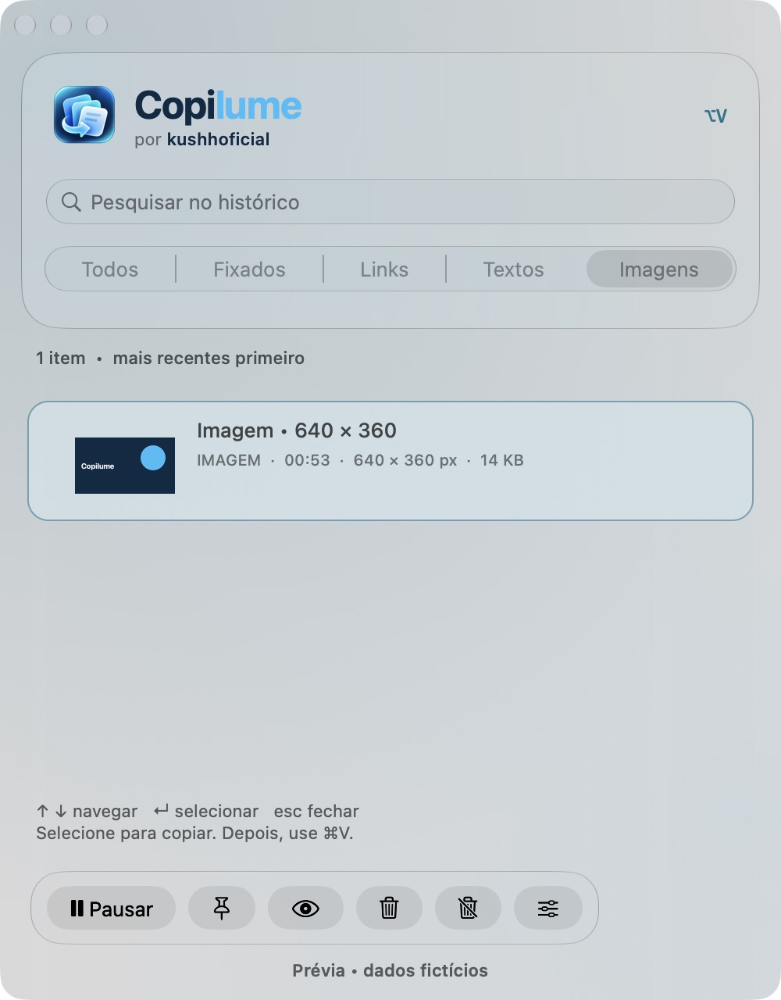

# Copilume

<picture>
  <source media="(prefers-color-scheme: dark)" srcset="Assets/LockupDark.svg">
  
</picture>

[](https://github.com/kushhoficial/Copilume/actions/workflows/build.yml)

**Copie agora. Reencontre depois.** Histórico de textos, links e imagens para macOS, gratuito e open source sob licença [MIT](LICENSE).


O Copilume traz a praticidade de Windows + V para o Mac: copie normalmente, abra com **Option + V**, pesquise e escolha o texto que quer usar novamente. Tudo funciona localmente, sem conta, servidor, telemetria ou API de IA.

O nome combina copiar com lume. As buscas públicas realizadas não retornaram resultados para “Copilume”; isso não certifica disponibilidade de marca, domínio ou nome em todas as lojas.

## Instalar

1. Baixe o DMG da [última versão publicada](https://github.com/kushhoficial/Copilume/releases/latest) e abra-o.
2. **Arraste Copilume.app para Applications**. Abrir o ícone dentro do DMG não instala o app.
3. Ejete o disco e abra Copilume pela pasta Aplicativos.
4. Depois de abrir, copie um texto ou uma imagem e pressione Option + V.
5. Para colagem automática, use Preferências → Autorizar colagem e conceda a permissão pelo painel oficial do macOS.

O pacote atual tem assinatura local ad hoc, **sem notarização Apple**. Um download em outro Mac pode ser bloqueado pelo Gatekeeper. Não desative proteções do sistema. Enquanto não houver uma versão notarizada, prefira recompilar a fonte no próprio Mac; o processo de distribuição assinada está em [DISTRIBUTION.md](docs/DISTRIBUTION.md).

Requer macOS **13+**, Apple Silicon ou Intel. O binário é universal; a execução foi validada em Apple Silicon. O vidro nativo (`NSGlassEffectView`) exige macOS 26+, com acabamento compatível nos anteriores. Efeitos variam com fundo, aparência e preferências de acessibilidade; o app respeita a redução de transparência.

[Baixar](https://github.com/kushhoficial/Copilume/releases/latest) · [Relatar problema](https://github.com/kushhoficial/Copilume/issues) · [Contribuir](CONTRIBUTING.md)

## Recursos

| Recurso | Como usar |
| --- | --- |
| Histórico global | Option + V; configurável nas preferências |
| Busca instantânea | Digite na busca; ignora diferenças de caixa e acentos |
| Navegação | ↑/↓, Enter para escolher, Esc para fechar |
| Fixados | Selecione um item e clique no alfinete; clique de novo para desafixar |
| Filtros | Todos, Fixados, Links, Textos, Imagens |
| Imagens | Miniatura, dimensões, visualização ampliada e cópia/colagem como PNG/TIFF |
| Visualizar conteúdo | Botão do olho; amplia imagens ou mostra o texto completo |
| Copiar sem colar | Clique com o botão direito no cartão |
| Copiar em uma linha | Menu de contexto; normaliza espaços, tabulações e quebras de linha |
| Pausar captura | Botão Pausar ou menu da barra |
| Excluir | Botão da lixeira ou menu de contexto |
| Limpar recentes | Lixeira riscada; preserva os fixados |
| Limpar tudo | Na mesma confirmação, escolha incluir os fixados |
| Aparência | Sistema, Claro ou Escuro, nas preferências |
| Conhecer o projeto | Menu “Conheça o Copilume” ou rodapé do histórico |

Os fixados permanecem na ordem de captura e podem ser encontrados pelo filtro próprio. São protegidos do descarte automático enquanto os limites permitem. O limite inicial é **200 itens**, configurável de 1 a 5000, com teto de 24 MB de conteúdo (textos e PNGs). Ao reduzir o limite além da quantidade de fixados, o limite máximo prevalece e os mais antigos também podem ser descartados. Se toda a capacidade estiver ocupada por fixados, novas cópias não entram até liberar espaço. Fixar não habilita gravação em disco: com persistência desativada, tudo é perdido ao sair, inclusive os fixados.

## Imagens

Copie a própria imagem de um navegador/editor, ou faça uma captura de tela para a área de transferência com Control + Shift + Command + 4. Abra Option + V, escolha **Imagens** e use Enter. O botão do olho abre uma prévia maior. Você pode fixar, excluir e limpar imagens como os outros itens.

Ao selecionar, o app oferece uma imagem real em PNG e TIFF. A colagem depende de o campo de destino aceitar imagens; editores de texto simples e campos de senha não aceitam. Se houver texto e imagem na mesma cópia, o app prioriza a imagem. Imagens consecutivas iguais após normalização não são repetidas.

A busca encontra o rótulo “Imagem” e suas dimensões; **não há OCR nem leitura do conteúdo visual**. GIFs e imagens com várias páginas guardam apenas o primeiro quadro/página raster. Orientação EXIF e transparência são preservadas na imagem normalizada, mas animação, camadas e metadados originais não são mantidos. Os arquivos de origem e URLs não são abertos ou baixados. Imagens que excedem os limites são ignoradas; uma imagem muito compactada pode passar a ocupar mais de 8 MB ao virar PNG.



## Permissão e colagem

Sem Acessibilidade, selecionar copia o texto ou a imagem e orienta o uso de Command + V. Com ela, o app tenta voltar ao aplicativo anterior e enviar Command + V, após confirmar o foco, a liberação dos modificadores e que o clipboard não mudou. Campos protegidos, sessões remotas ou aplicativos com atalhos próprios podem impedir a colagem.

- macOS 27: Privacidade e Segurança → **Controle do Dispositivo e Acesso a Dados**.
- macOS 13–26: Privacidade e Segurança → **Acessibilidade**.

Autorize o **app instalado**. A identidade é `io.github.kushhoficial.Copilume`; a autorização de protótipos anteriores não é transferida. Uma recompilação ad hoc pode exigir remover a entrada anterior e readicionar a versão instalada pelo painel oficial. O aplicativo não altera permissões automaticamente.

Não execute duas versões ao mesmo tempo: elas disputam Option + V. A atualização não remove protótipos nem migra dados antigos automaticamente. Faça a troca quando estiver pronto e preserve uma cópia de seus dados caso tenha ativado a persistência.

## Privacidade

Histórico **apenas em memória por padrão**. A captura consulta o clipboard a cada 0,4 segundo e não importa o conteúdo já existente quando o app inicia. Cópias consecutivas iguais são ignoradas; cópias muito rápidas podem ser perdidas. Textos até 2 MB por item. Imagens raster (PNG, TIFF, JPEG e formatos aceitos pelo ImageIO) são convertidas para PNG localmente, com no máximo 16 megapixels, 8192 px por lado e 8 MB por PNG. A representação de entrada deve ter até 32 MB. A conversão acontece em segundo plano; se o clipboard mudar durante a leitura, o resultado antigo é descartado. Não há captura de arquivos copiados pelo Finder nem sincronização.

Persistência é opcional e começa desativada. Quando ativada, grava JSON sem criptografia própria em `~/Library/Application Support/Copilume/history.json`, com diretório 0700 e arquivo 0600. Desativar apaga o arquivo salvo e mantém os itens atuais em memória. Textos e imagens não são registrados em logs. Imagens são incorporadas ao mesmo JSON, em base64, somente quando você habilita a persistência. O formato anterior de histórico continua legível.

São ignoradas marcações conhecidas de conteúdo confidencial e transitório, incluindo `org.nspasteboard.ConcealedType`, `org.nspasteboard.TransientType`, `org.nspasteboard.AutoGeneratedType` e marcações conhecidas do 1Password. A lista exata está em `Sources/History.swift`. **Isso não detecta toda senha**: depende do aplicativo que publica o conteúdo. Pause a captura antes de copiar segredos que não queira guardar.

Excluir itens não limpa o clipboard do macOS. Arquivos persistidos inválidos ou acima de 50 MB são recusados na leitura; preserve uma cópia antes de continuar capturando com armazenamento ativado se precisar recuperá-los.

## Compilar

Requer Command Line Tools ou Xcode com SDK macOS 27+ (o deployment target continua macOS 13). Na pasta do projeto:

```bash
./test.sh
./build.sh
./install.sh
```

A instalação por script usa `~/Applications/Copilume.app` e recusa sobrescrever destinos existentes. Para outro destino novo, use `./install.sh "/caminho/Copilume.app"`. Não rode uma versão de teste junto da versão em uso.

```bash
./package.sh
```

Gera o DMG e SHA-256 em `dist/`. O script recusa substituir um pacote existente da mesma versão. A suíte inclui testes do modelo, codec de imagens, pasteboard privado e integração da captura assíncrona. O build usa somente ferramentas do macOS, sem pacotes externos.

Para inspecionar com dados fictícios, sem captura do clipboard, registro do atalho ou envio de teclas, o executável aceita `--demo`. A opção `--dark` ou `--light` serve para inspeção visual. O modo de prévia não deve ser confundido com o uso normal.

## Desinstalar

Desative Iniciar ao entrar nas preferências, saia pelo menu e mova Copilume.app para a Lixeira. Opcionalmente mova `~/Library/Application Support/Copilume` para a Lixeira, remova a entrada do painel de privacidade e execute `defaults delete io.github.kushhoficial.Copilume` para apagar preferências.

## Projeto aberto

Código, assets da identidade oficial e licença MIT estão incluídos. Consulte a [origem e o uso dos assets](Assets/README.md). A assinatura **@kushhoficial** é preservada no menu “Conheça o Copilume”, nos créditos e na licença. O nome do aplicativo permanece Copilume. O repositório oficial é [kushhoficial/Copilume](https://github.com/kushhoficial/Copilume). Cada push em `main` e pull request executa testes e build universal. Tags `vX.Y.Z` publicam o DMG e SHA-256 em Releases somente depois que os testes e o build passam.

Veja [testes e limitações](docs/TESTING.md), [mudanças](CHANGELOG.md), [distribuição](docs/DISTRIBUTION.md) e o [identidade visual oficial](Assets/README.md).
