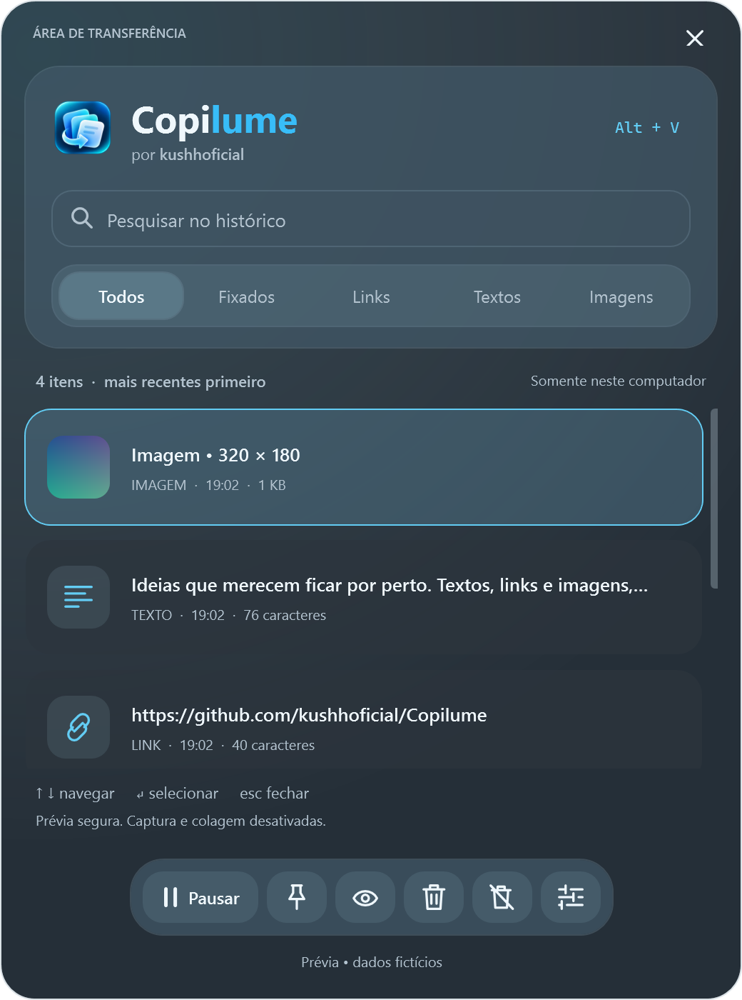

# Copilume para Windows

Aplicativo nativo WPF/.NET, por **kushhoficial**, com APIs públicas do Windows e sem pacotes de terceiros. O código macOS em Swift/AppKit continua independente e preservado.

## Usar

Requer Windows **10 22H2 ou Windows 11**, x64 ou ARM64. Baixe o ZIP correspondente à arquitetura nos artefatos da CI ou em uma Release que inclua Windows. A Release macOS v1.3.0 anterior a esta implementação não contém o pacote Windows.

1. Extraia **todo** o ZIP para uma pasta permanente de seu usuário.
2. Abra `Copilume.exe`. O runtime .NET já está incluído no pacote; não requer instalação separada nem administrador.
3. Copie um texto ou imagem e abra **Alt + V**. O conteúdo anterior à inicialização não é importado.
4. Digite para buscar, navegue com ↑/↓ e pressione Enter ou dê duplo clique para escolher. Esc fecha o painel. O ícone permanece na bandeja; use seu menu para sair.
5. Por padrão, escolher copia o conteúdo. Use **Ctrl + V** no destino. Para tentar colar diretamente, ative **Preferências → Colar automaticamente no aplicativo anterior**.

O atalho pode ser alterado nas preferências: clique no campo e pressione Ctrl, Alt ou Shift com uma letra/número. Combinações já ocupadas são recusadas e o atalho anterior é mantido. Atalhos com a tecla Windows são reservados para o sistema; o Win + V original continua disponível.

Os pacotes iniciais não têm assinatura Authenticode. O Windows pode apresentar alertas de reputação. Não desative SmartScreen nem outras proteções; para compilar localmente, veja abaixo.

## Recursos

- Textos, links HTTP/HTTPS e imagens PNG ou DIB/DIBV5 oferecidas pelo clipboard (inclusive capturas de tela).
- Busca sem distinguir caixa ou acentos; filtros Todos, Fixados, Links, Textos e Imagens.
- Miniaturas e prévia ampliada, conteúdo textual completo e selecionável.
- Fixar/desafixar, excluir, limpar recentes preservando fixados ou confirmar a limpeza total.
- Menu de contexto: copiar sem colar, copiar texto em uma linha, fixar, visualizar e excluir.
- Pausar/retomar captura, aparência Sistema/Claro/Escuro, suporte a alto contraste.
- Atalho global configurável, ícone de bandeja e início no login opcional, desligado por padrão.
- Persistência criptografada opcional, desligada por padrão.
- Interface inspirada na composição macOS: painel arredondado e redimensionável, cabeçalho em vidro, filtros segmentados, cartões compactos e barra de ícones. Preferências, prévia e apresentação seguem a mesma identidade.

O Windows 11 22H2+ pode usar **Desktop Acrylic**, pela [API pública do DWM](https://learn.microsoft.com/en-us/windows/win32/api/dwmapi/ne-dwmapi-dwm_systembackdrop_type). O efeito depende da versão do Windows, composição e opção de transparência; o Windows 10 usa o mesmo desenho com superfícies sólidas e gradientes suaves. Alto contraste e transparência desativada recebem superfícies sólidas. O material nativo é próprio do Windows e varia com o fundo; não é o Liquid Glass do macOS.




Os itens continuam na ordem de captura; fixar protege do descarte enquanto há capacidade. Limite inicial de 200 itens, ajustável de 1 a 5000, com teto total de 24 MB. O limite máximo prevalece sobre os fixados. Se todos os espaços estiverem ocupados por fixados, novas cópias podem ser descartadas. Fixar não habilita persistência.

Textos: no máximo 2 MB UTF-8. Imagens: entrada de até 32 MB; até 8192 pixels por lado, 16 megapixels e 8 MB por PNG normalizado. DIBs são validados antes da conversão. A imagem tem prioridade quando a cópia oferece texto e imagem. Imagens repetidas consecutivas não são duplicadas após normalização. O painel virtualiza as linhas e mantém no máximo 64 miniaturas em cache.

Não há OCR, sincronização, captura de arquivos do Explorer, abertura de URLs, download de imagens, importação do histórico Win + V ou migração automática de dados macOS. Animações, camadas e metadados originais não são preservados. A saída oferece PNG e bitmap nativo; o destino precisa aceitar imagens. DIBs antigos sem canal alpha podem perder a transparência conforme o formato fornecido pelo aplicativo de origem.

## Privacidade

Sem conta, servidor, telemetria ou IA. A captura usa notificações nativas (`AddClipboardFormatListener`); não lê o conteúdo que existia ao iniciar. Imagens são normalizadas fora da thread da interface, com um processamento por vez. Se a área de transferência mudar, o resultado antigo é descartado; a versão mais recente será lida. Cópias intermediárias muito rápidas podem ser perdidas. Pausar invalida trabalhos pendentes; retomar não importa o conteúdo copiado durante a pausa.

O histórico fica **apenas em memória por padrão**, inclusive os fixados. Ao sair, ele é perdido. Se habilitada, a persistência grava `%LOCALAPPDATA%\Copilume\history.dat`, protegido pelo **DPAPI do usuário atual do Windows**. Isso protege o arquivo fora dessa conta; aplicativos executados como o mesmo usuário podem descriptografá-lo. Não é um cofre de senhas nem um formato de sincronização entre computadores. Desativar a opção apaga o arquivo salvo e preserva a memória atual. Arquivos inválidos são preservados e a sessão passa a usar somente memória, para evitar sobrescrita automática. Preferências sem conteúdo ficam em `settings.json`, na mesma pasta.

O aplicativo ignora `ExcludeClipboardContentFromMonitorProcessing`, as marcações de confidencialidade usadas no Mac e valores zero/inválidos de `CanIncludeInClipboardHistory` ou `CanUploadToCloudClipboard`. Isso depende do aplicativo de origem e **não detecta toda senha**. Pause antes de copiar segredos. Ao escrever de volta, o Copilume marca o conteúdo para não entrar no histórico/nuvem do Windows. Não altera as configurações globais do Win + V nem limpa o clipboard quando você exclui um item.

Colagem automática é opcional. O Copilume verifica o foco, a liberação dos modificadores e a sequência do clipboard antes de enviar Ctrl + V. Aplicativos elevados, campos protegidos e sessões remotas podem impedir a colagem. O app roda sem elevação e não contorna restrições; nesses casos use Ctrl + V manualmente.

## Compilar e testar

Instale o **SDK .NET 10** oficial no Windows. Na raiz do repositório, em PowerShell:

```powershell
./test-windows.ps1
./build-windows.ps1
./package-windows.ps1
```

O teste usa somente dados sintéticos: modelo, criptografia, codec PNG/DIB, política de privacidade e abertura/renderização da interface nos dois temas. Inclui busca, filtros, fixação, pausa, troca de aparência, estados vazios, prévias, apresentação e tamanho mínimo. Não captura nem sobrescreve o clipboard real e não registra atalhos ou inicialização. As prévias ficam em `build/windows-preview/`, em resolução 2×. A renderização WPF usa o acabamento sólido do próprio app: ela não captura o material composto pelo DWM sobre o desktop.

O build gera `build/windows/<versão>/win-x64/Copilume.exe` com os arquivos de execução, separado das versões anteriores. O empacotamento gera `dist/Copilume-<versão>-windows-x64.zip` e `SHA256SUMS-windows-x64.txt`, recusando sobrescrever um pacote existente. Para ARM64:

```powershell
./package-windows.ps1 -Architecture arm64
```

Se o NuGet falhar ao extrair pacotes em um checkout com caminho longo, escolha um cache curto antes de restaurar: `$env:NUGET_PACKAGES = Join-Path $env:TEMP 'copilume-nuget'`.

A compilação ARM64 pode ser feita em x64; isso não equivale a executar em hardware ARM64. O ícone ICO é derivado do PNG oficial durante o build. A CI testa em Windows x64 e compila os dois pacotes. A CI macOS continua executando os testes Swift e o build universal. A publicação por tag exige sucesso de ambas as plataformas.

Prévia isolada:

```powershell
dotnet run --project Windows/Copilume.Windows.csproj -- --demo --dark
```

`--demo` não lê clipboard, preferências nem histórico, não grava dados, não registra atalho e não envia teclas. `--light` força o tema claro. Feche a janela ou use Alt + F4 para encerrar a prévia. Para uma prévia que encerra sozinha, acrescente `--smoke-test`.

## Atualizar ou remover

Saia pelo menu da bandeja antes de trocar os arquivos. Guarde conteúdos importantes: histórico sem persistência é perdido ao sair. Extraia a nova versão em uma nova pasta e atualize a opção de início no login se o caminho mudou.

Para remover, desative **Iniciar ao entrar no Windows**, saia e exclua a pasta extraída. Opcionalmente remova `%LOCALAPPDATA%\Copilume`. Se já removeu o executável, exclua apenas o valor `Copilume` de `HKCU\Software\Microsoft\Windows\CurrentVersion\Run`, ou desabilite a entrada pelas configurações de inicialização do Windows.

## Validação e limites da entrega

Consulte `WINDOWS-TESTING.md` para resultados e lacunas. Testes do modelo e renderização não substituem validação manual de Alt + V, bandeja, captura e colagem em aplicativos reais. Não foram executados os testes macOS neste ambiente Windows. A distribuição automática está configurada; só uma execução bem-sucedida no GitHub confirma a CI e a publicação.
